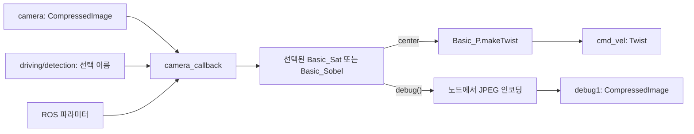

# driving

팀원들이 개발한 차선 검출과 조향 알고리즘을 하나의 ROS 2 노드에서 연결하는 Python 패키지다. 카메라 영상을 받아 선택된 검출기를 실행하고, 조향기가 만든 `Twist`를 발행한다. 알고리즘별 전처리와 디버그 영상 생성은 각 알고리즘 파일에 둔다.

**목표 환경은 ROS 2 Galactic / Python 3.8이다.** 다른 배포판에서 실행했다면 해당 환경과 검증 범위를 따로 기록한다.

- 사용 방법과 현재 상태: 이 문서
- 새 알고리즘 이식 방법: [CONTRIBUTING.md](CONTRIBUTING.md)
- 에이전트의 수정 원칙: [AGENTS.md](AGENTS.md)

## 구조와 역할

```text
driving/
├── driving/
│   ├── driving.py              # ROS 통신, 선택, 파라미터 조회, 호출 순서
│   ├── detection/
│   │   ├── basic_sat.py        # 밝기 변환을 이용한 검출
│   │   └── basic_sobel.py      # Sobel 경계를 이용한 검출
│   └── steering/
│       └── basic_p.py          # 중심 위치를 이용한 조향 계산
├── package.xml
├── setup.py
├── README.md
├── CONTRIBUTING.md
└── AGENTS.md
```

`__init__.py`, 패키지 리소스 등은 위 설명에서 생략했다.

| 구성 요소 | 담당하는 일 |
| --- | --- |
| `DrivingNode` | 구독·발행, 선택 이름 관리, 객체 생성, 파라미터 조회, 알고리즘 호출 |
| 검출기 | 영상 디코딩, 자체 전처리와 ROI, 검출 계산, 미검출 정책, 디버그 표시본 생성 |
| 조향기 | 검출 결과를 해석해 `Twist` 계산 |

노드에서 명시적인 `if` 분기로 검출기를 호출한다. 객체는 시작할 때 한 번 생성하고 재사용한다. 새로운 알고리즘도 기존 호출 흐름을 읽으며 연결할 수 있도록 작성한다.



영상 콜백 안에서 검출 → 조향 → 속도 발행 → 디버그 처리를 순서대로 실행한다. 현재는 별도 worker나 동적 플러그인 등록 기능이 없다.

## 현재 알고리즘의 의미

기본 조합은 `basic_sat` + `basic_p`다. 검출기는 `basic_sobel`로 바꿀 수 있다.

두 검출기 모두 디코딩 결과가 **640×480 BGR 영상**이어야 한다. 이를 640×120으로 원근변환한 뒤 왼쪽 또는 오른쪽의 320×120 ROI 하나를 처리한다.

| 항목 | 현재 basic 구현 |
| --- | --- |
| 왼쪽 모드 | `lane_mode=True`, 원근변환 영상의 `x=0:320` |
| 오른쪽 모드 | `lane_mode=False`, 원근변환 영상의 `x=320:640` |
| 반환값 `center` | 선택한 ROI 내부의 x좌표. 정상 검출 좌표 범위는 0~319 |
| 차선 미검출 | 검출기가 왼쪽 0 / 오른쪽 320을 반환 |
| `Basic_P` 목표 위치 | 왼쪽 ROI에서는 60, 오른쪽 ROI에서는 260 |
| 디버그 영상 | 처리한 이진 ROI를 BGR로 변환하고 `(center, 60)`에 빨간 점 표시 |

`basic_sat`은 회색 영상에 `clip(29.12 * 밝기 + beta, 0, 255)`를 적용한 뒤 이진화한다. HSV 채도를 조절하는 계산은 아니다. `basic_sobel`은 x방향 경계, 이진화, 형태학 처리, 작은 연결요소 제거로 검출한다.

한쪽 ROI 안에서도 여러 윤곽의 중심이 평균에 포함될 수 있다. 미검출 대체값에도 빨간 점이 찍히므로, 점이 있다는 사실만으로 유효 차선을 검출했다고 판단하면 안 된다. 오른쪽 대체값 320은 영상 오른쪽 경계 밖이어서 원의 일부만 표시된다.

이 좌표계와 미검출 정책은 현재 basic 조합의 규칙이다. 새 알고리즘의 반환 형식을 모두 여기에 맞추도록 강제하지 않는다. 연결할 조향기가 해석할 수 있는 결과를 제공하고 의미를 문서화한다.

## 빌드와 실행

ROS 2와 colcon, rosdep이 준비된 환경에서 사용한다. 의존성은 `rclpy`, `sensor_msgs`, `geometry_msgs`, `std_msgs`, OpenCV, NumPy이며 [package.xml](package.xml)에 선언돼 있다.

다음은 저장소를 `~/turtlebot3_ws/src/driving`에 둔 경우다. 작업 공간 위치가 다르면 `DRIVING_WS`를 바꾼다.

```bash
source /opt/ros/galactic/setup.bash
DRIVING_WS="$HOME/turtlebot3_ws"
cd "$DRIVING_WS"
rosdep install --from-paths src/driving --ignore-src -r -y
colcon build --symlink-install --packages-select driving
source install/setup.bash
ros2 run driving driving --ros-args -r cmd_vel:=cmd_vel_preview
```

위 실행 예제는 계산 결과를 `/cmd_vel_preview`로 보내 연결을 확인한다. 실제 `/cmd_vel`에 연결할 때는 `-r cmd_vel:=cmd_vel_preview`를 제거한다. 현재 노드에는 `cv2.imshow("test", ...)` 호출도 있으므로 GUI를 사용할 수 있는 환경이 필요하다.

카메라 발행기나 bag 재생기는 별도로 실행해야 한다. 이 패키지는 입력 영상을 만들지 않는다. 현재 basic 검출기는 `/camera`의 640×480 영상을 사용하므로 `/camera_raw_16_9`만 발행되는 bag을 재생해도 계산이 시작되지 않는다. 다른 토픽을 remap할 때도 해상도와 메시지 타입이 맞아야 한다.

새 터미널마다 ROS 및 작업 공간의 setup을 읽고, 통신할 노드끼리 `ROS_DOMAIN_ID` 등 ROS 통신 설정을 맞춘다. Humble에서 확인한 결과는 Galactic 실행 검증과 구분한다.

## 토픽

소스에서는 상대 이름을 사용한다. 아래 이름은 별도 namespace나 remap 없이 실행했을 때 기준이다.

| 이름 | 방향 | 메시지 | 현재 용도 |
| --- | --- | --- | --- |
| `/camera` | 구독 | `sensor_msgs/msg/CompressedImage` | 차선 검출·조향을 실행하는 입력 |
| `/camera_raw` | 구독 | `sensor_msgs/msg/CompressedImage` | 마지막 메시지 저장만 수행 |
| `/camera_raw_16_9` | 구독 | `sensor_msgs/msg/CompressedImage` | 마지막 메시지 저장만 수행 |
| `/driving/detection` | 구독 | `std_msgs/msg/String` | `basic_sat`, `basic_sobel` 선택 |
| `/driving/steering` | 구독 | `std_msgs/msg/String` | 현재 허용값은 `basic_p` 하나 |
| `/cmd_vel` | 발행 | `geometry_msgs/msg/Twist` | 계산한 선속도·각속도 |
| `/debug1` | 발행 | `sensor_msgs/msg/CompressedImage` | 선택된 검출기의 JPEG 디버그 영상 |
| `/debug2` | 발행자 생성 | `sensor_msgs/msg/CompressedImage` | 현재 메시지 발행 없음 |

영상 구독 3개는 `qos_profile_sensor_data`를 사용한다. 선택 구독 및 발행자는 depth 10의 기본 QoS를 사용한다. `raw`라는 이름의 두 입력도 현재 메시지 타입은 비압축 `Image`가 아닌 `CompressedImage`다.

```bash
ros2 topic pub --once /driving/detection std_msgs/msg/String "{data: basic_sobel}"
ros2 topic pub --once /driving/detection std_msgs/msg/String "{data: basic_sat}"
```

선택 콜백은 허용된 이름을 저장하고, 이후 영상 콜백이 해당 분기를 실행한다. 빈 문자열과 목록 밖 이름은 경고를 남기고 무시한다. 이미 처리 중인 프레임을 중단하거나 객체를 새로 만드는 방식은 아니다. 조향은 두 검출 분기 모두 현재 `Basic_P`를 직접 호출한다.

## 파라미터

| 이름 | 타입 / 기본값 | 반영 위치 |
| --- | --- | --- |
| `basic_sat.beta` | 실수 / `-5080.1` | Sat의 고기울기 밝기 변환. alpha는 29.12 고정 |
| `basic.lane_mode` | bool / `true` | 선택된 검출기의 ROI와 `Basic_P`의 좌우 조향 기준 |

```bash
ros2 param get /driving basic_sat.beta
ros2 param set /driving basic_sat.beta -5000.0
ros2 param get /driving basic.lane_mode
```

Sat 분기는 매 프레임 beta를 읽는다. beta를 높이면 같은 입력 밝기가 더 큰 변환값을 갖는다. Sobel 실행 중 바꾼 beta는 Sat을 다시 선택한 뒤 적용된다. 실수 파라미터는 `-5000.0`처럼 실수로 입력한다.

`basic.lane_mode`는 Sat/Sobel 분기에서 매 프레임 읽으며, 검출 함수와 `Basic_P.makeTwist(center, lane_mode)`에 같은 값을 인자로 전달한다. `true`는 왼쪽, `false`는 오른쪽이다. 검출 알고리즘을 바꾸거나 왼쪽으로 돌아와도 해당 프레임에 전달된 모드로 조향한다.

`Basic_P`는 좌우 모드를 객체 상태로 저장하지 않고 함수 인자로 받은 값을 사용한다. `makeTwist(center)`처럼 두 번째 인자를 생략하면 기본값 `True`로 왼쪽 기준을 사용하므로, 노드의 실행 분기에서는 해당 프레임의 `lane_mode`를 매번 전달한다.

```bash
ros2 param set /driving basic.lane_mode false
ros2 param set /driving basic.lane_mode true
```

런타임 변경값은 재시작하면 유지되지 않는다. 시작할 때 지정하려면 다음처럼 실행한다.

```bash
ros2 run driving driving --ros-args -r cmd_vel:=cmd_vel_preview -p basic_sat.beta:=-5000.0
```

`normal_angular_divisor` 등 조향기의 설정은 현재 소스의 상수이며 ROS 파라미터로 노출돼 있지 않다.

## 알려진 문제와 현재 범위

- **디버그 header:** 현재 출력 시각을 사용하고 `frame_id`는 비어 있다. 원본 영상의 header를 보존하지 않으므로 입력과 디버그 영상을 촬영 시각으로 대응시키는 기능은 없다.
- **입력 오류와 미검출:** 검출 중 `ValueError` 또는 `cv2.error`가 발생하면 노드는 0 `Twist`를 발행한다. 정상 영상의 차선 미검출은 검출기의 0/320 대체값으로 조향하며 정지와 다르다. `Basic_P`의 `None` 대체 처리는 주석 처리돼 있다.
- **동기 처리와 정지:** 처리 중인 영상 콜백이 오래 걸리면 같은 executor의 다음 콜백도 지연될 수 있다. 입력 중단을 감시하는 타이머와 종료 시 명시적인 0 `Twist` 발행은 없다.
- **디버그 실행:** GUI 표시와 JPEG 처리는 영상 콜백에서 실행한다. 디버그 함수는 검출·조향의 예외 처리 범위 밖에 있으며, 별도 디버깅 노드는 현재 패키지에 없다.
- **raw 입력 활용:** 두 raw 콜백은 저장만 한다. 다른 알고리즘에 연결할 때 입력 준비 여부와 처리 시작 시점을 정해야 한다. 세 영상의 시간 동기화는 구현돼 있지 않다.
- **남아 있는 설명:** 일부 주석에는 미검출을 `None`으로 반환한다고 적혀 있고 Sobel의 해상도 오류 문구에는 `basic_sat`이 남아 있다. 실제 반환값과 위 설명을 기준으로 읽는다.

알려진 문제를 해결하면 구현과 이 목록을 함께 갱신한다. 새 알고리즘의 이식 순서와 확인 방법은 [기여 가이드](CONTRIBUTING.md)를 따른다.
